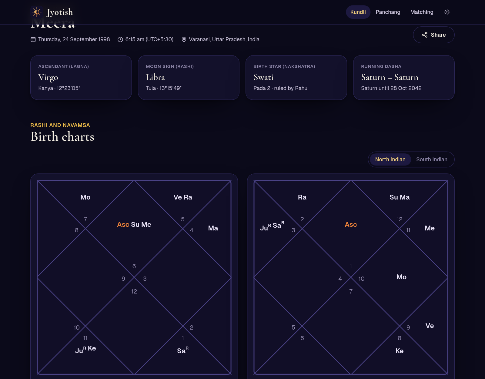
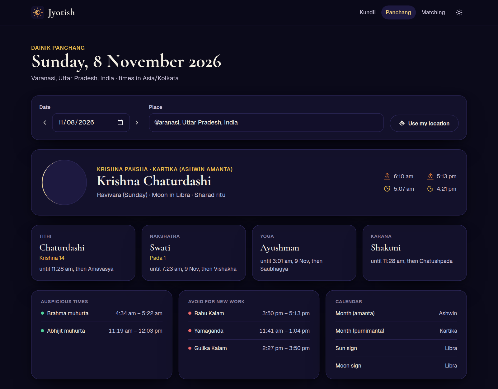
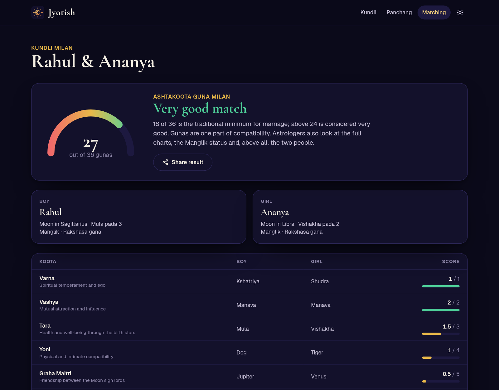

<div align="center">


# Jyotish

**Free, open-source Vedic astrology: your kundli with North and South Indian charts, Navamsa and Vimshottari dasha, the daily panchang for any city, and kundli matching with Guna Milan. Calculated by its own astronomical engine. No sign-up, no API keys, nothing stored.**

[](LICENSE)
[](https://nextjs.org)
[](tests)

**Live:** <https://jyotish-vedic.netlify.app> · [**Watch the demo video**](docs/media/jyotish-demo.mp4)

[](docs/media/jyotish-demo.mp4)

</div>

Most astrology sites are slow, covered in ads, want your phone number, or quietly call a paid API for every
chart. Jyotish does the astronomy itself: it works out where the Sun, Moon and planets were, applies the Lahiri
ayanamsa, and builds the chart from there. Your birth details live only in the page's link.

## Features

- **Kundli (birth chart)**
  - Ascendant, Moon sign (rashi), birth star (nakshatra) and pada, and the dasha you're in now.
  - **Rashi (D1)** and **Navamsa (D9)** charts, in **North Indian** or **South Indian** style.
  - All nine grahas with sign, degree, nakshatra, pada and its lord, house, Navamsa sign, and whether each is
    retrograde, exalted, debilitated or in its own sign.
  - **Vimshottari dasha**: all nine mahadashas over 120 years with every antardasha; the running one is open.
  - **Manglik** check from both the ascendant and the Moon.
  - Short readings for your ascendant, Moon sign and nakshatra (symbol, deity, gana and yoni).
- **Panchang** for any city and date: tithi, nakshatra, yoga and karana, each with the exact time it ends;
  sunrise, sunset, moonrise and moonset; Rahu Kalam, Yamaganda and Gulika Kalam; Abhijit and Brahma muhurta;
  the lunar month (amanta and purnimanta, with adhika months) and ritu; and a drawing of the Moon's phase.
  "Use my location" works too.
- **Kundli matching**: Ashtakoota Guna Milan out of 36, with all eight kootas side by side, Nadi and Bhakoot
  doshas called out, and both people's Manglik status.
- **Shareable links**: every kundli, panchang and match is a URL. Bookmark it or send it; nothing is saved
  on a server.
- **Place search** with the right time zone for every city, including historical offsets such as India's
  UTC+6:30 war time in 1942–45 and daylight saving abroad.
- **Dark and light themes**, works on phones.

| Kundli | Panchang | Matching |
| --- | --- | --- |
|  |  |  |

## How accurate is it?

Positions come from [Astronomy Engine](https://github.com/cosinekitty/astronomy) (MIT), which models the planets
to within about an arcminute. Jyotish converts them to the sidereal zodiac with the Lahiri ayanamsa, uses the mean
node for Rahu and Ketu as most Vedic software does, and whole-sign houses from the ascendant.

The test suite checks the engine against [FreeAstrologyAPI](https://freeastrologyapi.com), a professional
Swiss-Ephemeris-based service, for ten births from 1952 to 2031 in India, London, New York and Sydney
([`tests/api.test.ts`](tests/api.test.ts)):

| | Agreement |
| --- | --- |
| Lahiri ayanamsa | under 1″ |
| Ascendant, Rahu, Ketu | under 10″ (in practice 0″) |
| Sun | under 20″ |
| Moon and planets | under 2′ |
| Retrograde flags, tithi, nakshatra end times | identical |
| Vimshottari dasha | same lords; dates within hours |
| Guna Milan | identical for Varna, Vashya, Tara, Yoni, Graha Maitri, Bhakoot and Nadi |

Two documented differences: Jyotish applies ΔT (the difference between atomic time and Earth's rotation), so its
Moon is a few tens of arcseconds ahead of the API's; and for Gana and same-nakshatra Tara it follows the common
North Indian tables where the API uses a variant. The API's answers are saved in
[`tests/fixtures`](tests/fixtures), so the tests run offline without a key; refresh them with
`FREE_ASTROLOGY_API_KEY=… node scripts/fetch-fixtures.mjs`.

## Run it

```bash
npm install
npm run dev        # http://localhost:3000
npm test           # 155 tests
npm run typecheck && npm run lint
```

No environment variables are needed. Place search uses [Open-Meteo's free geocoder](https://open-meteo.com/en/docs/geocoding-api)
from the browser.

**Deploy:** it's a standard Next.js app. On Netlify, `netlify.toml` is already set up: connect the repo, or run
`npx netlify-cli deploy --build --prod`.

## How it's built

```
src/lib/astro/
  ephemeris.ts   sidereal longitudes, Lahiri ayanamsa, mean node, ascendant
  kundli.ts      placements, houses, navamsa, dignity, Manglik
  dasha.ts       Vimshottari mahadashas and antardashas
  panchang.ts    tithi, nakshatra, yoga, karana with end times, muhurtas, lunar month
  matching.ts    Ashtakoota Guna Milan
  time.ts        local birth time in an IANA zone -> UTC
src/app/         Next.js pages: / kundli panchang matching support
docs/video/      the scripted, narrated demo recording
```

Pages are server-rendered from the URL, so a shared link opens straight to the chart, and the engine is plain
TypeScript with no network calls.

The demo video is recorded from the running site with Playwright and narrated with Kokoro TTS:
`npm run build && npx next start -p 3022`, then `node docs/video/demo.mjs`.

## ☕ Buy me a coffee

I build Jyotish on my own time and keep it free for everyone. If it saved you time, taught you something, or
powers something you're building, a coffee is the kindest way to say thanks, and every one buys me more hours to
build and improve Jyotish and my other open-source projects.


**UPI ID: `8941951465@axl`** (or **+91 8941951465**). Scan the code with Google Pay, PhonePe, Paytm, BHIM or
any UPI app; international payments are welcome too.

However small, every coffee keeps the work going. Thank you! A star on GitHub or sharing Jyotish with a friend
helps too.

## License

[MIT](LICENSE) © Aman Jha
